# Tavus Echo integration

## Architecture

The workflow owns the patient's clinical response and resolves its audiovisual profile. Audio synthesis remains an authorized API request, and the browser transports the synthesized PCM audio to Tavus Echo over the private Daily room.

```mermaid
flowchart LR
    Student[Student speech or text] --> Input[React input and transcription]
    Input --> Messages[FastAPI interview message endpoint]
    Messages --> Graph[LangGraph: patient response]
    Graph --> Translate[Translate and apply personality]
    Translate --> Profile[Prepare patient speech profile]
    Profile --> Persist[Persist transcript and profile metadata]
    Persist --> UI[React transcript]

    UI --> TTSRequest[Authenticated speech request]
    TTSRequest --> TTS[Azure OpenAI TTS]
    TTS --> MP3[MP3 audio]
    MP3 --> PCM[React: decode and convert to PCM16 mono]

    UI --> SessionRequest[Authenticated avatar-session request]
    SessionRequest --> API[FastAPI: resolve language and patient profile]
    API --> FaceMap[Select face: gender, age, personality]
    FaceMap --> TavusConversation[Tavus conversation]
    TavusConversation --> Credentials[Private room URL and meeting token]
    Credentials --> DailyJoin[React joins Daily room]
    PCM --> Echo[Echo audio events]
    DailyJoin --> Echo
    Echo --> Tavus[Tavus Echo face render]
    Tavus --> DailyMedia[Remote Daily audio and video]
    DailyMedia --> UI
    DailyMedia --> Recording[Existing interview recording]
```



The graph stage prepares and persists the shared patient profile; it does not run a second TTS request or move media through LangGraph. Tavus video is a WebRTC/Daily stream, not a video payload proxied through FastAPI.

## Patient profile

The profile keeps the selected interview language, personality and gender consistent across message metadata, TTS and Tavus session creation.

| Input | Effect |
|---|---|
| Language (`en`/`es`) | Passed to Azure TTS instructions and Tavus conversation `properties.languages`; configure the PAL to support both languages. |
| Personality | Selects the existing voice and vocal-style policy (pace, pauses, energy, intonation, hesitation and delivery tone). |
| Patient gender | Selects the existing TTS voice and optionally a matching Tavus face. |

Echo receives the already synthesized audio. Its animation is synchronized to that audio; the Echo flow does not expose a separate arbitrary facial-emotion control per turn. Personality-specific prosody is therefore the expressive control available to this integration. Validate voices and pronunciation with prepared English and Spanish clinical examples rather than assuming equivalent quality across languages.

## Configuration

Set these variables only in ignored runtime `.env.local` or `.env.full` files:

| Variable | Purpose |
|---|---|
| `TAVUS_API_KEY` | Server-side Tavus API key. Never sent to React. |
| `TAVUS_PAL_ID` | Echo-mode PAL configured for the required languages. |
| `TAVUS_FACE_ID` | Default face and fallback when a gender-specific face is unset. |
| `TAVUS_FACE_ID_MALE` | Optional face override for male patients. |
| `TAVUS_FACE_ID_FEMALE` | Optional face override for female patients. |
| `TAVUS_FACE_MAP` | Optional JSON object mapping patient traits to faces (see below). |
| `TAVUS_MAX_CALL_DURATION_SECONDS` | Maximum provider conversation duration. |

The local/full environment examples list the optional gender-specific face IDs, and both Compose configurations forward them to the API. Create the PAL through Tavus's [Echo Mode quickstart](https://docs.tavus.io/sections/conversational-video-interface/echo-mode), and make sure its supported languages include the interview languages. Restart/recreate the API after changing runtime configuration.

### Face selection by gender, age and personality

`TAVUS_FACE_MAP` is a single-line JSON object. Keys use `gender` (`male`/`female`), an age group derived from the clinical case age (`young` ≤ 39, `adult` 40–64, `senior` ≥ 65) and optionally the personality key (for example `friendly_polite`). The most specific matching key wins:

1. `gender:age_group:personality`
2. `gender:age_group`
3. `gender:personality`
4. `gender`

If nothing matches, the API falls back to `TAVUS_FACE_ID_MALE`/`TAVUS_FACE_ID_FEMALE` and then to `TAVUS_FACE_ID`. Example:

```
TAVUS_FACE_MAP={"male:young":"<face_id>","male:senior":"<face_id>","female:adult":"<face_id>","female:senior:anxious":"<face_id>"}
```

Personality otherwise only affects voice and vocal style, because Echo mode has no per-turn emotion control.

Personality keys usable in `TAVUS_FACE_MAP`:

| Key | Intended look |
|---|---|
| `elderly_forgetful` | Older, gentle, uncertain |
| `know_it_all` | Confident, assertive |
| `rude_unfriendly` | Serious, stern |
| `friendly_polite` | Warm, smiling |
| `confused_inquisitive` | Curious, puzzled |
| `skeptical_spiritual` | Calm, reserved |

Example: `"female:rude_unfriendly":"<face_id>"`. Patients without a matching key use the gender face.

## API and UI session contract

`POST /medical-interviews/{id}/avatar/session` is restricted to the authenticated owner of an in-progress interview. It creates a private conversation and returns:

```json
{
  "provider": "tavus",
  "state": "created",
  "conversation_id": "provider-id",
  "conversation_url": "private-room-url",
  "meeting_token": "scoped-token",
  "patient_profile": {
    "language": "es",
    "personality_key": "friendly_polite",
    "gender": "female",
    "voice": "nova",
    "vocal_style_key": "friendly_polite"
  }
}
```

The URL and scoped meeting token are returned only to the authorized browser. React's session state is `idle → connecting → ready → speaking`; any connection/provider error becomes `failed`, retains the static avatar and local Azure TTS fallback, and is surfaced in the call tile. `DELETE /medical-interviews/{id}/avatar/session` ends the active provider session. Audio and video tracks received through Daily continue into the existing recording path.

## Latency measurement and validation

- The speech endpoint returns a `Server-Timing: synthesis;dur=...` header and emits a content-free synthesis-duration log.
- In a development UI, the browser Performance panel records elapsed time from student message submission to response receipt, TTS completion, PCM conversion, Echo delivery and Tavus's first speaking event. The connection path separately records session creation, room join and first video track.
- Timings do not include patient text or audio. Do not add transcript, credentials, or raw media to telemetry.
- Current behavior waits for the full MP3, decodes/resamples it, then sends Echo chunks. Smaller chunks alone do not remove the wait for full synthesis/decoding. Do not claim streaming or change the Echo chunk protocol until a real Tavus account validates frame format, ordering, lip-sync and end-to-end benefit.
- With a real provider account, verify both languages, every supported personality/gender combination, join/rejoin and teardown, first video frame, remote audio capture, static/TTS fallback and pause/resume behavior. Provider cost, concurrency, consent and data-processing terms must be reviewed before real-participant use.
