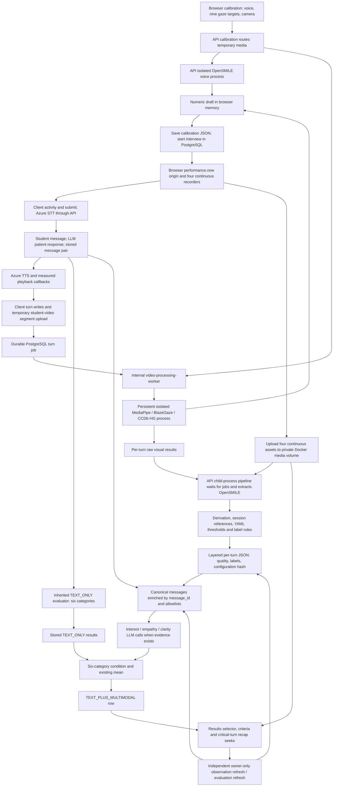

# Experiment readiness audit — Virtual Patient

Date: 13 October 2026 (America/Bogota). Scope: the current local working tree, not the published GitHub default branch. Base commit: `bf9eed3b46553a30f7e29ae1c9f42df6a7d7105c` (23 September 2026), plus existing uncommitted API/UI/configuration/documentation changes, including the complete six-category evaluation extension. Line references below refer to this working tree and may shift after edits.

This first phase changed no production source, prompts, thresholds, dependencies, migrations or deployment configuration. No commit/push, live participant records, production database access, destructive migration, or paid Azure call was used. New files are confined to this audit directory. Tests used existing Docker images/services, synthetic fixtures and mocks; build outputs are ordinary ignored artifacts. The sibling manuscript repository and all pre-existing work were preserved. This technical report is written in English under the repository's technical-documentation convention.

## A. Executive verdict

**NOT READY for recruitment or collection of the final participant dataset.**

The application has a substantial functioning implementation and the requested six-category evaluation contract. The blockers are not principally missing screens: timestamps can refer to asynchronous processing instead of observed events; missing visual evidence can become sustained gaze or zero nods; poor audio can produce valid-looking labels; results cannot be reconstructed as immutable runs; public teacher registration grants sensitive access; and the participant data/provisioning/retention arrangements are not demonstrably reconciled with the protocol. Executable synthetic probes confirm several of these behaviors. Passing tests and completing extraction do not establish signal accuracy or clinical validity.

Development and controlled nonparticipant fixture testing can continue. Recruitment requires the GO checklist in section H and documented institutional authorization. The audit did not inspect consent signatures or an external committee decision and does not make a legal determination.

### What is working and should be preserved

- The registry contains exactly `show_interest`, `show_empathy`, `speak_clearly` with category and speaker allowlists. General communication, completeness and open communication are copied from TEXT_ONLY without additional LLM calls.
- Completion passes the same canonical message snapshot to both conditions; message content/order survives association by `message_id`, including messages without turns. Turn transcript is no longer the multimodal textual source.
- Multimodal prompts retain the complete inherited prompt as a literal prefix, including examples, criteria and score anchors. This reduces prior confounding but does not eliminate the output/prompt-format difference.
- Six results and the existing rounded six-score mean are stored for TEXT_PLUS_MULTIMODAL. UI uses the selected persisted overall. Original is the default view. Copied categories do not gain an empty multimodal criteria section.
- A category with no usable authorized integrated label copies its textual result and records unavailability; it does not receive a newly sampled score. LLM failure does not fabricate a multimodal score. Unknown/duplicate critical IDs are filtered, with at most three retained.
- Condition uniqueness, media path containment, private media access, per-turn durable jobs, native-process isolation during normal extraction, single-consumer coordination and independent review actions provide useful foundations.

The application overall includes completeness. The thesis primary communication outcome excludes it and keeps five categories/24 criteria. General/open condition differences are zero by construction: only three categories test added evidence. Neither the six-category app mean nor correlation alone demonstrates added value.

## B. Map of the actual architecture



### Responsibilities and boundaries

| Owner | Actual responsibility | Important boundary |
| --- | --- | --- |
| React `InterviewCalibration`, `useTechnicalCalibration`, media context | Permissions, checkpoint capture, geometry sampling, assembling/persisting numeric draft | Browser guidance is not a validated gaze detector; draft is client-controlled |
| React `useInterviewRecording`, `ServerSpeechTranscriptionProvider`, `ConversationTranscript` | Four continuous sources, turn clips, session clock, activity timing, transcription requests and TTS playback | Several independent clocks/queues and pause states must agree |
| Docker API | FastAPI authentication, PostgreSQL orchestration, STT/TTS adapters, LLMs, final audio pipeline and review actions | Some synchronous work runs from async/background endpoints |
| Docker `video-processing-worker` | One advisory-lock-owned consumer, interactive-priority calibration and durable turn jobs | All users share a single heavy processor; interactive jobs may delay turn completion |
| Isolated native visual process | Reused BlazeGaze/CCDb-HG models, reset clip-local state; MediaPipe once per sampled frame | Normal turn jobs and full-video review are different execution paths |
| PostgreSQL/pgvector | Messages, calibration JSON, turn jobs, layered evidence, two evaluation rows; LangGraph checkpoints and memory | Research lineage/attempt history is not an immutable first-class record |
| Docker media volume | Private continuous recordings and temporary turn clips | No implemented automatic expiry; upload and filesystem transactions are separate from DB commits |
| Nginx production UI | TLS, same-origin `/api/` proxy, static UI | Unlimited body size and long proxy timeouts are not resource admission control |

There is no running dedicated audio queue service in local Compose: audio calibration/extraction belongs to the existing API image/process architecture. Setup initializes the database; it is not an extra application runtime. The audit did not start a replacement development environment.

### Review coverage and omissions

Inspected capture/STT/TTS/hooks, calibration stages and models, visual adapters and aggregation, OpenSMILE derivation, threshold and label engines/configuration, evaluation prompts/schemas/formatter/service, persistence/controller/routers/migration 029, authentication and user roles, private media storage, results/recap/criteria flows, deployment Compose/Dockerfiles/Nginx, dependency manifests and relevant tests. Read current internal protocol and the prior interest audit, then checked its claims against current code.

No authenticated browser session with participant content was opened. No real hardware/browser matrix, production DB revision, operational backup, Azure model response, consent signature, deployment TLS configuration, load test with real interviews or expert annotations was verified. These are explicit missing evidence, not assumed passes or proof that the deployment already suffered an incident.

## C. Findings matrix

Severity: P0 blocks the experiment or threatens privacy/data integrity; P1 can materially bias results; P2 concerns reliability/performance/maintainability; P3 is optional. State: **Confirmed** means a code path/diagnostic establishes the behavior, not a demonstrated incident; **Potential** means reachability or severity depends on deployment/load; **Requires measurement** means empirical performance cannot be established from source/tests.

| ID | Priority | Area | State | Problem |
| --- | --- | --- | --- | --- |
| F01 | P0 | Event timing | Confirmed | Patient end time includes prior asynchronous work |
| F02 | P1 | Pause/clock | Confirmed | Historical timestamps change after later pauses; turn clips are not paused with continuous media |
| F03 | P1 | Media integrity | Confirmed | Source durations are copied client metadata, not measured encoded durations |
| F04 | P1 | Gaze dwell | Confirmed | Unavailable frames and temporal holes do not break dwell |
| F05 | P1 | Coverage | Confirmed | Sparse valid frames can describe a whole turn without a quality gate |
| F06 | P1 | Nods | Confirmed | Global evaluability becomes local zero nods, even with zero local frames |
| F07 | P1 | Nod timing | Confirmed | Events bridge prediction holes; overlaps double-count; interpolation accepts >100 ms spacing |
| F08 | P1 | Reprocessing | Confirmed / measurement needed | Clip-boundary and continuous inference are not equivalent |
| F09 | P1 | Audio quality | Confirmed | Clipping/insufficient voiced duration do not invalidate generated labels |
| F10 | P1 | Audio definitions | Confirmed | F0-positive time and F0-negative runs stand in for articulation/silence; requested duration rescales frames |
| F11 | P1 | Calibration validity | Confirmed / measurement needed | Passed operational checks do not establish out-of-sample accuracy or continued geometry validity |
| F12 | P1 | Gaze target semantics | Confirmed | PATIENT ROI is the whole panel, not the face; camera state has precedence |
| F13 | P1 | Thresholds/references | Confirmed | Provisional bands and small, mixed-context percentile populations define labels |
| F14 | P1 | Experimental control | Confirmed / measurement needed | Historical T and M still differ in wrappers, instructions and output task |
| F15 | P1 | Technical failures | Confirmed | Historical numeric 2.5 fallbacks can be stored/copied as valid-looking performance |
| F16 | P1 | Feedback validity | Requires measurement | Real IDs and a prompt do not verify factual grounding or absence of cue-based penalties |
| F17 | P0 | Reproducibility | Confirmed | Overwritten evaluations lack immutable input/model/prompt/run lineage |
| F18 | P1 | Stale results | Confirmed | New observations can coexist with an old score without explicit staleness |
| F19 | P1 | Frozen interview | Confirmed | Completed messages/turns can change; tied timestamps lack an ordering tie breaker |
| F20 | P1 | Recovery/concurrency | Confirmed / potential | Completion/review background tasks are nondurable; partial commits and duplicate starts lack recovery |
| F21 | P0 | Authorization | Confirmed | Public teacher role grants replay and broad transcript access |
| F22 | P0 | Sensitive logging | Confirmed | Active inherited paths print prompts, responses, summaries or interview objects |
| F23 | P0 | Consent/provider scope | Confirmed discrepancy; approval unverified | Azure audio/text/embedding flows are not reconciled with protocol's internal-transfer statement |
| F24 | P0 | Retention/deletion | Confirmed / operational verification needed | No expiry workflow; media deletion does not encompass independent memory/checkpoint/backup stores |
| F25 | P1 | Temporary privacy | Confirmed | Rejected oversized calibration retains a temporary file |
| F26 | P0 | Dependency security | Confirmed affected inventory; exploit not run | Multipart runtime uses advisory-affected versions; wider inventory requires reachability triage |
| F27 | P1 | Memory/resource use | Confirmed growth; capacity potential | Full-video reprocessing retains frame arrays and runs in API process |
| F28 | P2 | Scheduling/performance | Confirmed structure; latency requires measurement | Singleton priority queue, no admission/fairness and different local/full resource bounds |
| F29 | P1 | Interview fidelity | Confirmed mechanisms; rates require measurement | Transcript can include unheard TTS or exclude student speech; failures/duplicate retries lack reconciliation |
| F30 | P2 | Sessions/browser transport | Potential | JS-readable tokens, dev defaults and cookie-authenticated media depend on deployment/host matching |
| F31 | P2 | Frontend quality/status | Confirmed / measurement needed | Full lint fails; recap conflates retrieval failure with no recording; device/accessibility coverage is missing |
| F32 | P0 | Empirical qualification | Requires measurement | No demonstrated timing/detector/feedback/expert validation on the intended population/devices |

### F01 — Patient end follows queue processing instead of the playback event

**Evidence:** `virtual-patient-ui/src/hooks/useInterviewRecording.ts:545–579`, `endPatientTurn`, especially `endMs: elapsedAt()` at 562 inside `turnWritesRef.current.then(...)` after `await segmentPromise`.

**Root cause:** the event is not converted to a fixed session-relative end before asynchronous writes/uploads. **Experimental impact:** listening windows, nod rates, ROI association and continuous-video reprocessing can include later student behavior. A label can be attached to the wrong conversational moment.

**Reproduction:** `readiness_probes.sh` executes the actual extracted TypeScript callback with a held prior-write promise. Playback ends at 10,000 ms; releasing the queue at 14,000 ms stores 14,000 ms, a measured synthetic 4,000 ms drift. This is not a hardware drift benchmark.

**Recommended solution:** snapshot start/end session coordinates at event time, before queues/awaits, and use them in all writes/uploads. **Regression:** hold prior upload and recorder-stop promises independently; stored event boundaries must remain identical. Test multiple pending turns and completion during a delayed upload.

### F02 — Later pauses retroactively affect old timestamps and clips continue recording

**Evidence:** `useInterviewRecording.ts:158–163` (`elapsedAt`), 165–194 (turn recorder), 486–504 (`pause`/`resume`), 598–599 (`recordStudentTurn`).

**Root cause:** `elapsedAt(historicalTimestamp)` subtracts the *current cumulative* paused duration, including pauses after that event. Pause/resume iterates `recordersRef` for continuous sources, not `turnSegmentRef`. **Impact:** queued historical writes can shift backward; clip media time and compensated session time can disagree across hypotheses/pause/resume.

**Reproduction:** actual clock callback returns 5,000 ms for a historical event, then 2,000 ms after a later 3,000 ms pause is accumulated. Inspect active clip state during pause. **Solution:** event-time coordinates or an interval-aware clock map; pause/close every active turn source under one policy. **Regression:** events before/during/after several pauses, pending STT and writes, zero/short turns, and hypotheses cancellation.

### F03 — “Common source duration” is asserted, not independently measured

**Evidence:** `useInterviewRecording.ts:195–226` (`stopRuntime` copies `durationMs` into every `sourceDuration`); `app/routers/interview_recordings.py:363–504` (`finalize_recording`); `app/paraverbal/opensmile_extractor.py:164–205` (requested duration determines frame duration).

**Root cause:** API validates declared source-duration proximity and nonempty uploads, not encoded duration/PTS/track continuity. **Impact:** sequential recorder startup, browser throttling, truncation and stop delays can survive as apparently synchronized assets; audio timing is rescaled to a potentially false interval.

**Reproduction:** controlled media shorter than its declared duration, irregular PTS, delayed recorder startup. Not executed against real browsers. **Solution:** FFprobe/decoder duration and PTS validation, source start offsets, track settings and measured drift metadata, explicit incomplete-source states. **Regression:** reject/mark mismatched media; ensure extraction uses actual frame/sample timestamps and does not stretch EOF to the requested turn.

### F04 — Missing gaze observations manufacture sustained episodes

**Evidence:** `app/nonverbal/preprocessing.py:122–133` and `_median_aligned_dwell_ms:241–278`.

**Root cause:** UNAVAILABLE states are removed before run segmentation and elapsed gaps never end a run. **Impact:** loss of tracking can inflate “sustained visual orientation” rather than reduce available evidence.

**Reproduction:** PATIENT at 0 ms, UNAVAILABLE at 1,000 ms, PATIENT at 5,000 ms yields ratio 1.0 and dwell 5,000 ms in the executed probe. **Solution:** explicit gap-aware episodes with an observation-time policy and missing periods retained. **Regression:** unavailable/out-of-screen states, skipped timestamps, single-frame episodes, frame-rate changes and long holes; no episode may span an unobserved interval silently.

### F05 — Sparse valid samples can become confident whole-turn descriptions

**Evidence:** `preprocessing.py:122–164,431–466`; `video_observations.py:217–288`; `conversation_formatter.py:58–65`; `label_glossary.py:4–16`.

**Root cause:** ratios divide by valid samples; minimal local duration/coverage eligibility is not imposed here. Formatter checks integrated status but does not inspect coverage/quality. Glossary wording uses “proportion of the turn.” **Impact:** biased missingness becomes behavioral evidence; the no-penalty rule cannot protect an accepted low-coverage label.

**Reproduction:** one active smile sample out of 600 sampled frames yields smile ratio 1.0/mean 0.7. **Solution:** predefined per-family observation-duration/coverage gates; descriptions restricted to valid observations. Under the requested label-only LLM contract, filter/mark low-quality labels upstream rather than silently injecting numeric features. **Regression:** 0/1/few/many valid samples, clustered validity and systematic missingness; unavailable must never turn into absent behavior.

### F06 — Zero nods without local evaluable windows

**Evidence:** `ccdbhg.py:208–218` (`NodAnalysis.evaluated`), `video_observations.py:228–241` (`build_turn_raw_features`), `pipeline.py:655–684` (global full-video analysis then per-turn segmentation).

**Root cause:** a global evaluated flag supplies zero for any window lacking assigned events; evaluated-window intervals are not retained locally. **Impact:** full-video recovery can describe a turn with no face data as “no nodding”; partial clip coverage also produces misleading whole-turn absence/rates.

**Reproduction:** empty local observations plus globally evaluated empty events yields count 0/rate 0 and all frame counts 0. **Solution:** retain evaluable temporal windows and require local coverage for real zeros. **Regression:** one valid turn plus one completely invalid turn, partial/short clips, no events with good coverage, and failures restricted to one branch.

### F07 — Nod grouping/assignment does not enforce temporal continuity or exclusivity

**Evidence:** `ccdbhg.py:150–168` (`resample_windows`), 221–243 (`_smooth`, `nod_events`), 246–251 (`assign_nods_to_turns`); `video_observations.py:230–237`.

**Root cause:** missing predictions disappear; smoothing/merging uses list positions. Midpoint assignment checks each window independently. The resampling gate tests distance to the closest sample, not the complete bracketing gap. **Impact:** a nod can bridge lost tracking, have its midpoint in a hole, appear twice in overlapping turns, or be inferred across spacing documented as unacceptable.

**Reproduction:** executed probes merge two positive blocks separated by ~10 seconds into one 0–10,099 ms event; assign one event to both overlapping turns; accept 150 ms-spaced observations into seven windows with `max_gap_ms=100`. **Solution:** time-aware runs/interpolation eligibility and explicit single-owner overlap policy without suppressing genuine overlaps. **Regression:** timestamp holes, border events, irregular spacing, duplicate/overlapping windows, event-duration/source-window consistency.

### F08 — Turn clips and continuous recovery are scientifically different pipelines

**Evidence:** `turn_video_queue.py:180–286` (`process_turn_video_job`, local 0–duration window); `pipeline.py:590–699`; `gaze.py:123–160` (`reset_tracker`); `mediapipe_extractor.py:18–44,94–156`.

**Root cause:** normal inference resets tracking/Kalman and truncates nod context at every clip boundary; continuous recovery has longer context and global events. Clip metadata and local media may also differ in length because of F01–F03. **Impact:** refreshing analysis can change labels because of processing topology rather than behavior, even with unchanged thresholds.

**Reproduction:** same controlled session analyzed both ways; nod crossing a turn boundary, initial gaze adaptation, overlapping turns. Numerical agreement was not measured here. **Solution:** canonical extraction/window contract or documented boundary padding and deterministic reconciliation; preserve processing-mode version. **Regression:** paired per-turn feature/label comparisons with predefined tolerances, including gestures straddling boundaries and invalid turns.

### F09 — Audio quality warnings are not eligibility gates

**Evidence:** `opensmile_extractor.py:164–205`; `paraverbal/preprocessing.py:90–164`; `pipeline.py:808–840` (`_paraverbal_layer`); `conversation_formatter.py:58–63`.

**Root cause:** insufficient voiced duration and clipping are recorded as issues, but preprocessing/thresholding proceeds and the layer becomes OK. **Impact:** clarity/empathetic delivery can be assessed from unreliable acoustic evidence instead of falling back to text.

**Reproduction:** synthetic raw input with 100 ms voiced duration, 2% voiced ratio and clipping flag produces articulation rate 6,000 words/min and an OK integrated temporal label. **Solution:** per-feature acoustic eligibility and quality failure propagation; do not interpret voiced-frame coverage as general audio quality. **Regression:** silence, clipping, short utterances, missing F0, noise, all-unvoiced and corrupted segments; invalid acoustic features must not influence the LLM.

### F10 — Timing proxies and duration rescaling have unvalidated semantics

**Evidence:** `opensmile_extractor.py:171–180,220–246`; `paraverbal/preprocessing.py:97–141`; `nonverbal/calibration_worker.py:164–183` (`process_voice`).

**Root cause:** positive F0 is used as voiced/effective articulation time; nonpositive runs including leading/trailing runs are treated as pause candidates. Frame time is requested duration divided by descriptor count; finite-value filtering can remove temporal positions. Word count comes from transcript. **Impact:** consonants/STT errors/boundary silence/truncation change articulation and pause labels without an equivalent behavioral change. Synthetic tonal/noisy signals may satisfy voiced baseline checks without valid speech.

**Reproduction:** controlled annotated audio with unvoiced consonants, long edges, false STT words and shorter actual media. Formulas were inspected; empirical errors were not estimated. **Solution:** validate/rename proxies consistently, preserve actual sample/descriptor time, separate internal pauses from boundary delay and freeze definitions before the final dataset. **Regression:** compare timing/rates with annotations and quantify error by duration/device/noise, not just expected arithmetic.

### F11 — Calibration is operationally checked but not maintained across geometry changes

**Evidence:** `gaze_calibration.py:18–28,31–76,105–123`; `useTechnicalCalibration.ts:109–138`; `InterviewCalibration/index.tsx:85–126`; `calibration_worker.py:117–162`; `medical_interviews.py:220–235,320–363`; `multimodal/calibration.py:174–211`.

**Root cause:** fit errors are predominantly on calibration targets used to fit; leave-one-target-out is diagnostic. Geometry stability is emitted for the gaze stage, not bound across all checkpoints/session/device changes. Saved “passed” draft is client-controlled and validates required baseline/profile presence, not an attested result or continued device geometry.

**Impact:** moving a laptop/camera, resizing/orienting, switching streams or later head displacement can produce valid-looking wrong alignment. Passed is more than “procedure finished,” but less than independent accuracy assurance. **Reproduction:** resize after gaze but before camera/session; move camera after all checks; submit synthetic passed profile. **Solution:** versioned device/geometry binding, stable checkpoints and monitoring that invalidates affected families or requires recalibration; held-out accuracy assessment. **Regression:** cross-stage/device/orientation transitions and baseline-profile consistency; predeclared held-out target error and semantic-state agreement.

### F12 — The “patient region” is wider than the patient face

**Evidence:** `CallStage.tsx:53–72` (`data-patient-roi-anchor` spans the panel); `useInterviewRecording.ts:436–450`; `gaze_calibration.py:171–185` (`classify_gaze`, camera precedence and ROI margin).

**Root cause:** the rectangle comes from an `absolute inset-0` anchor rather than avatar/face bounds. CAMERA matches first and PATIENT has an additional margin. **Impact:** looking at panel background/name can count toward patient alignment; large-camera radius can absorb other interface regions. These are approximate visual orientation, not direct eye contact or attention.

**Reproduction:** controlled points at panel corners/background, overlapping camera ROI, viewport resize and note-taking outside the panel. **Solution:** decide face versus panel operational target explicitly, use its actual bounds and validate state confusion; keep CAMERA/PATIENT separately traceable. **Regression:** region geometry tests and annotated gaze-state comparison per device; no automatic performance penalty for legitimate note-taking.

### F13 — Band/percentile labels depend on unvalidated and unstable references

**Evidence:** `config/thresholds.yaml:38–43,95–146`; `config/label_rules.yaml:95–140`; `pipeline.py:389–396,977–1014`; `label_engine.py:236–281`; `label_glossary.py:7,10`.

**Root cause:** fixed visual/temporal bands are provisional, session reference minimum is zero and nonverbal values mix speaking/listening turns with unequal durations/coverage. Partial feature sets can become an OK mixed fallback. **Impact:** adding speaking turns changes listening frequency labels; one turn defines its own “typical” reference; glossary “comparable” is stronger than implementation. Tiny measurement changes cross qualitative boundaries.

**Reproduction:** boundary tests are covered by the suite; enumerate labels with the supplied rule audit; add high-rate speaking turns without changing a listening turn. **Solution:** fix eligibility/reference population and descriptive terminology in advance, validate bands without choosing them to improve expected scores; distinguish observed mixed evidence from fully characterized families. **Regression:** P25/P75 ties, one/two qualifying turns, role/duration stratification, all missing and partial data. Executed exhaustive configured label combinations found no unreachable rule; overlaps are intentional first-match semantics, not automatically bugs (see section E).

### F14 — A matched experimental text control is still needed

**Evidence:** `evaluation_agent.py:67–78,125–143`; `prompts/multimodal_evaluation.py:32–48`; `conversation_formatter.py:50–71`.

**Root cause:** M adds behavioral interpretation/negative critical-turn instructions, persistent-ID wrappers and a larger output schema; M explicitly uses function calling while T uses the inherited default structured-output configuration. Identical criteria/examples and transcript do not make the tasks identical. **Impact:** M–historical T can reflect framing, context length and output-task effects independently of signals.

**Reproduction:** unavailable-cue ablation with the *same M prompt/schema/wrappers* versus original T on synthetic transcripts; requires authorized LLM runs, not executed. **Solution:** preserve Andrea's historical T and add a separately named matched text control for the experiment/ablation; do not replace historical results. **Regression:** identical prompt/schema/input-wrapper/configuration hashes for matched T versus M except evidence values; verify repeated-score distribution before interpreting a cue effect. A blank-evidence fallback that simply copies historical T does not test this confound.

### F15 — Errors have valid-looking numeric scores in the historical evaluator

**Evidence:** `evaluation_agent.py:84–92,307–341` and completeness/verification exception branches; `evaluation_service.py:21–46`; `models/medical_interview/interview_evaluation.py:24–56`.

**Root cause:** exceptions return ordinary EvaluationResult objects with 2.5 and an error-text feedback; there is no structured invalid-result status. **Impact:** six-category checks/means/copying can accept a technical failure as participant performance. It can contaminate both conditions and study selection.

**Reproduction:** existing mocks can force structured-model failures; inspect persisted/copied 2.5 results. **Solution:** retain historical behavior if necessary for compatibility but add experiment validity metadata and exclude technical failures from paired performance under a predefined rule; never silently treat feedback-string errors as valid ratings. **Regression:** fail each category/completeness phase, partial LLM response and provider timeout; invalid scores cannot enter performance exports or expert-error calculations.

### F16 — Valid IDs do not verify the feedback's claims

**Evidence:** `agents/schemas/multimodal_evaluation.py:7–38`; `prompts/multimodal_evaluation.py:32–43`; `conversation_formatter.py:58–65`.

**Root cause:** reference validation checks membership/duplicates/count/annotation shape, not truth, temporal accuracy or whether a missing cue was penalized. **Impact:** a correct UUID can support an invented statement; no-nod/no-smile/monotone cues may be overinterpreted despite instructions. Actual incidence requires empirical measurement.

**Reproduction:** empathetic text with no smile/nod or low prosodic variation; serious concern with smile; unavailable evidence; note-taking gaze; transcript injection. **Solution:** a grounding review protocol with observed family/turn/provenance references, contradiction tests and expert annotation of feedback claims. **Regression:** adversarial prompt cases plus blinded audiovisual claim checks, false-observation and unsupported-inference rates; do not call a parser test clinical validation.

### F17 — A result cannot be reconstructed as an immutable experimental run

**Evidence:** `models/medical_interview/interview_evaluation.py:23–58`; `controllers/interview_evaluation_controller.py:37–53`; `evaluation_service.py:43–75`; `core/azure_openai.py:26–76`; `config_loader.py` and `_persist_turn`, `pipeline.py:893–949`.

**Root cause:** evaluation rows are overwritten, with no immutable transcript/enriched-input snapshot/hash, prompt/glossary hash, resolved deployment/model version, parameters, raw structured response, retry/attempt record, extractor/processing-mode linkage or unique run ID. YAML hashes and `policy_version` are partial provenance, not a historical chain.

**Impact:** a later change or retry can make published notes irrecoverable and encourage untracked result selection. **Reproduction:** regenerate after editing a glossary/prompt/model or evidence; previous evaluated input and result disappear from the main row. **Solution:** immutable runs with versioned input/evidence lineage and a separate current-result pointer; freeze source/container/model/configuration artifacts. **Regression:** reconstruct a run byte-for-byte after configuration changes, preserve failed and superseded attempts, preserve the original control association and verify exports against run IDs.

### F18 — Refreshed evidence and previous results can appear simultaneously current

**Evidence:** `multimodal/reprocess.py:42–70`; `ClinicalChat/index.tsx:330–358`; `EvaluationResultsPanel.tsx:59–66,220–250`; `interview_recordings.py:701–708`.

**Root cause:** observation refresh overwrites evidence without marking the evaluation as derived from an older observation version. The UI correctly keeps independent actions, but has no current-versus-stale run relation. Refresh queue seeding also replaces evaluation status metadata until new results are written.

**Impact:** a reviewer sees updated labels with a score/critical annotation generated from different labels; stale negative claims seem auditable. **Reproduction:** refresh observations only, then inspect the old result against the updated recap; fail the following evaluation refresh. **Solution:** evidence generation IDs and explicit stale state; show generation used by each result and distinguish unchanged valid history from current evidence. **Regression:** success/failure/interruption of each independent action, reload mid-refresh and metadata retention.

### F19 — Interview contents are not frozen; tied timestamps lack a total order

**Evidence:** `interview_recordings.py:195–242` (turn upsert), 246–325 (clip upload), 363–425 (finalization); `interview_messages.py:52–84` (send checks start but not completed status); `medical_interview.py:42` (message relationship ordered by created_at); `medical_interview_controller.py:75–82,325–338` (ORM messages used for evaluation); `message_controller.py:58–70` (history query also orders by created_at).

**Root cause:** some owner-only mutation routes lack lifecycle guards; captured turns can be edited while existing jobs retain their old boundaries/payload. Both evaluation/history paths do order by created_at, but neither defines an ID/sequence tie breaker. **Impact:** initial T and M share a snapshot, but regeneration can evaluate changed messages against frozen TEXT_ONLY; traceability/UI playback can diverge from saved jobs. Different ordering is a residual risk specifically for tied timestamps, not a claim that all current queries are unordered.

**Reproduction:** synthetic completed interview POST message/PUT turn/re-finalize; equal created_at values read across fresh DB sessions/query plans. No participant record was mutated and no real ordering failure was measured. **Solution:** freeze transcript/turns/media after completion, require explicit versioned corrections, define a total canonical message order and immutable baseline association. **Regression:** every mutation endpoint rejects incompatible lifecycle states; job-turn boundary consistency and tied-order tests across fresh DB sessions.

### F20 — Nonvisual processing is not durably scheduled; partial state can survive failures

**Evidence:** `medical_interviews.py:121–207,573–651`; `interview_recordings.py:415–504,678–726`; `evaluation_service.py:43–75`; `process_isolation.py:22–72`; `video_processing_worker.py:81–99` (durable recovery only for visual jobs).

**Root cause:** completion/observation/evaluation refresh is committed as pending then run using FastAPI BackgroundTasks or a child spawned by that request process. There is no demonstrated restart recovery/lease for those tasks. Completion lacks the review flow's row-lock guard against duplicate work. Results and processing metadata commit in separate transactions.

**Impact:** restart can leave processing forever; duplicate completion can issue extra LLM calls; TEXT_ONLY may remain stored when M fails and interview becomes interrupted. The latter changes the completed-pair sample. **Reproduction:** controlled staging restart after each commit, duplicate completion, fail the metadata commit after result commit; not done on live DB. **Solution:** extend existing durable job architecture with bounded recovery/idempotency/leases for these operations; atomic result/status transactions; separate technical failure from participant abandonment. **Regression:** kill/restart and duplicate requests at every transition, preserving first valid attempt and no misleading final state.

### F21 — Public teacher registration is incompatible with sensitive access boundaries

**Evidence:** `models/user.py:67–76` (`UserCreate` accepts teacher); `routers/users.py:20–43` (default active organization); `interview_recordings.py:126–132` (`_require_replay_access`); `medical_interview_controller.py:315–323,606–628` (duplicate method, final definition grants teachers access to any interview); `interview_hypotheses.py:48–86` (write uses broad access).

**Root cause:** trust to become a teacher is self-declared; media access is organization-wide and transcript/other operations use an even broader overridden policy. There is no explicit expert assignment scope. **Impact:** a newly registered account can access others' identifiable recordings in its organization and broad transcripts; some writes share the same overly broad check. This violates the intended least-access study workflow even if it was authorized product behavior.

**Reproduction:** executed synthetic schema/policy probe accepts public teacher and permits another owner's same-organization replay. Real records were not read. **Solution:** study deployment requires controlled teacher provisioning/verification, separate read/write/owner policies, organization and assigned-interview scopes, and no public privileged-role escalation. **Regression:** unauthorized public role, cross-organization read, unassigned expert, student cross-access and teacher mutation; one canonical authorization method with explicit role/organization/assignment checks.

### F22 — Sensitive content is printed by active inherited paths

**Evidence:** `agents/virtual_patient_agent.py:171–175` (`print(interview_prompt)`); `virtual_patient_workflow.py:138,167,190` (patient/translated content); `evaluation_agent.py:316–317` (case/hypotheses); `routers/interview_hypotheses.py:66` (interview object); `controllers/virtual_patient_controller.py:82–105` (active workflow integration).

**Root cause:** debug prints bypass the privacy-safe operational logging convention. **Impact:** conversation-derived memories, names, summaries and responses can persist in container logs and backups outside media retention/access controls. The audit did not fetch live logs or establish an actual disclosure.

**Reproduction:** mock/synthetic dialogue through active workflow and capture stdout; static call sites already confirm content logging. **Solution:** remove/redact content-bearing logging, log only technical identifiers/counts/types, and include operational logs in retention/access governance. **Regression:** capture logs/stdout on success and every error path with unique synthetic secret-like markers; none may appear.

### F23 — External processing and participant consent scope are unresolved

**Evidence:** `speech/azure_openai.py:130–208`; `routers/speech.py` (`transcribe_audio`); `core/azure_openai.py:69–94` (chat/embeddings); `controllers/virtual_patient_controller.py:82–96` (memory embeddings); workspace `doc/STUDY_PROTOCOL.md:128–139` (provider discrepancy).

**Root cause:** active student audio, conversation text and derived textual memories leave the local app for configured Azure services; the supplied internal protocol explicitly says the provider/identifiable-transfer statement still needs reconciliation. `consent_basis="institutional"` is not a signed permission or purpose-specific approval.

**Impact:** collecting real identifiable data before reconciling actual provider processing creates a governance blocker. **Reproduction:** inspect provider request arguments with synthetic mocks; verify consent/protocol/provider agreement externally before recruitment. **Solution:** documented data-flow/retention/location/access assessment and approved, purpose-specific consent/provisioning process; block study capture without an authorized participant record. **Regression/acceptance:** operational proof of approval and consent before first capture, valid withdrawal process and mock provider checks showing only authorized fields are transmitted. No legal-compliance claim is made here.

### F24 — Retention/deletion does not cover the complete research footprint

**Evidence:** `interview_recordings.py:66–69,168–181` (no expiry); `medical_interviews.py:709–744` (owned deletion, filesystem removed before DB commit); `enhanced_memory_manager.py:23–50` (independent store namespace); `virtual_patient_controller.py:82–105` (PostgresStore/PostgresSaver); `models/medical_interview/interview_recording.py:61–65`.

**Root cause:** no scheduled expiry or consent revocation workflow; relational cascade/media deletion does not explicitly delete independent LangGraph checkpoint/store histories, external logs, TTS locations and backups. DB and filesystem cannot roll back together; commit failure after media removal restores rows referring to missing media.

**Impact:** withdrawal/retention cannot be proven end-to-end and retained copies can outlive removed interviews. **Reproduction:** staging-only synthetic interview across all stores, delete/fail commit, inventory remaining namespace/checkpoint/files/backup references. **Solution:** retention manifest, authorized deletion jobs with tombstones/retries/verification, explicit graph/store and backup handling, study end date and expiration. **Regression:** removal/revocation with synthetic markers in every store and recoverable failed deletion; do not run destructive tests on participant data.

### F25 — A rejected calibration upload leaks its temporary file

**Evidence:** `routers/calibration.py:207–237` (`_write_upload_to_temp`), 272–311 and 354–407 (caller temp_path assigned only on success).

**Root cause:** a NamedTemporaryFile is created with delete=False; overflow/read failure closes it but does not delete it. The outer finally still has temp_path=None if the helper raised before returning. **Impact:** rejected sensitive capture remains unexpectedly on disk and may exhaust temporary storage.

**Reproduction:** executed probe limits a synthetic upload to 5 bytes, writes 4, then exceeds the cap; HTTPException occurs and one 4-byte temporary file remains. The probe's own TemporaryDirectory cleans only its synthetic file. **Solution:** helper-owned deletion on every failure/cancellation; transfer ownership only on success. **Regression:** overflow, read/write/fsync exceptions and cancellation, verifying zero leftovers before/after each stage.

### F26 — Advisory-affected runtime/development dependencies need controlled remediation

**Evidence:** `requirements.txt:2–10,20–34,47–55`; installed API inventory; UI `package.json`/`yarn.lock`; `nginx.conf:10` (`client_max_body_size 0`); active multipart endpoints. Executed Yarn/OSV lookups; representative primary sources below.

**Root cause:** old web/security and build-tool pins plus unpinned transitive/image versions. Installed Starlette 0.36.3 falls within the maintainer's multipart DoS affected range. Upload-handler caps execute after framework parsing and do not by themselves fix parser resource behavior. See [Starlette maintainer advisory GHSA-f96h-pmfr-66vw](https://github.com/Kludex/starlette/security/advisories/GHSA-f96h-pmfr-66vw) and [large-file parsing advisory](https://github.com/Kludex/starlette/security/advisories/GHSA-2c2j-9gv5-cj73).

**Impact:** sessions may be disrupted and sensitive systems have untriaged attack surface. UI findings include Vite dev-server file reads ([maintainer advisory](https://github.com/vitejs/vite/security/advisories/GHSA-p9ff-h696-f583)); production static Nginx is a different exposure. Inventory matches in Keras/Torch require trusted model/artifact reachability review: CCDb-HG verifies pinned artifact hashes before loading, an existing mitigating control. Do not equate scanner severity with a demonstrated exploitable production path.

**Reproduction:** `dependency_inventory_audit.sh` queries public advisories with only package names/versions; no exploit was attempted. **Solution:** triage reachable web/auth paths first, coordinated compatible FastAPI/Starlette/multipart/jose updates in existing dependency files/images, bounded parsing/uploads, lock/SBOM/digests and offline trusted model artifacts. **Regression:** multipart limits, valid/rejected tokens, media/calibration API, trusted model inference compatibility and rerun scanners; no arbitrary “upgrade everything” refactor.

### F27 — Full-video recovery can retain gigabytes and bypass normal crash isolation

**Evidence:** `video_observations.py:130–192` (bounded producer queue but retained observation list); `shared_observations.py:10–27` (frame arrays retained); `pipeline.py:640–684`; `reprocess.py:46–53` (imports/runs full visual pipeline in API process); local Compose API memory cap at 75.

**Root cause:** every enriched observation retains full image arrays until whole-video analysis ends. The queue capacity of eight bounds pending producer work, not the accumulated result. Explicit review extraction runs natively inside an API process, unlike normal finalization's child isolation and worker serialization.

**Impact:** OOM/native failure during a long refresh can disrupt other sessions or leave stuck status. **Reproduction:** synthetic long continuous video/RSS curve on staging, plus controlled native crash; not run because a stress crash is unnecessary to demonstrate retained growth. **Solution:** stream compact landmarks/gaze/smile/pose summaries, retain only temporal detector buffers; route recovery through existing worker/isolated resources with job limits. **Regression:** bounded RSS as video duration increases, API survives worker abort, and concurrent sessions remain responsive. Analytical memory estimate in section E is not a benchmark.

### F28 — Queue priority and deployment limits do not prove capacity

**Evidence:** `video_processing_worker.py:34–41,68–74,101–135,139–228,244–298,370–382`; `constants.py:6–13`; local Compose:74–97 versus full Compose API/worker definitions.

**Root cause:** one heavy consumer with strict interactive priority and an unbounded in-memory priority queue; no per-user admission/fairness. Timed-out calibration requests are shielded and may continue waiting/processing, holding temporary media. Local CPU/RAM/thread settings differ from full deployment. Health treats advisory-connection presence as lock-held rather than independently proving current lock ownership.

**Impact:** calibration bursts can delay finalized jobs beyond timeouts; redundant abandoned tasks consume capacity; DB connection loss may undermine singleton assumptions. **Reproduction:** staging priority flood, cancelled calibrations, DB disconnection and concurrent interviews. **Solution:** bounded admission, job cancellation/leases, starvation policy, real lock/liveness checks and measured full-deployment limits. **Regression:** fairness/backpressure and queue-wait distributions under planned participant concurrency; test timeout budgets jointly rather than in isolation.

### F29 — Canonical text can differ from the actual spoken interaction

**Evidence:** `ServerSpeechTranscriptionProvider.ts:162–197,216–272`; `useHandsFreeSpeech.ts:73–114`; `ClinicalChat/index.tsx:426–472,480–523`; `ConversationTranscript.tsx:61–134,184–198`; `interview_messages.py:191–233`; `message_controller.py:16–41`.

**Root cause:** TTS source text is kept even when playback fails/ends early; no word-level playback completeness exists. Mic/STT are deliberately disabled while the patient has the floor, suppressing overlaps/backchannels; server STT starts recording before activity onset and stops on submission, not a validated speech-boundary detector. Failed STT is not durably reconciled to an utterance. Student/patient message creation commits separately; retries lack an exchange idempotency key.

**Impact:** both conditions can agree on text that the student never heard or omit what they actually said. Lost/duplicated responses and transcript-word count bias audio measurements; half-duplex interaction limits claims about natural turn taking. **Reproduction:** TTS failure halfway, response lost after DB commit, repeat send, recognition failure, very short acknowledgments, silent segment and speech during patient audio. Rates were not measured. **Solution:** explicit captured/recognized/heard statuses and playable TTS extent, safe exchange idempotency/atomic persistence, recoverable failed utterances; define half-duplex constraints in the protocol without introducing an unsolicited new interaction architecture. **Regression:** controlled speech/TTS traces against stored messages/turns and audible/captured intervals.

### F30 — Token/media transport and configuration depend on deployment assumptions

**Evidence:** `services/auth/authHeaders.ts:1–5`, `authCookie.ts:1–4`; `utils/apiFetch.ts:20–43`; `routers/interview_recordings.py:96–112,731–770`; `core/config.py:27–31,73–84`; `docker-compose.local.yml:9–13,78,126`; production Nginx TLS proxy.

**Root cause:** access tokens are JS-readable cookies/Bearer headers; media elements depend on the cookie reaching the API host. localhost versus 127.0.0.1 can work for Bearer fetch but fail cookie-authenticated video. Development fallback secrets and long tokens are not guarded by a study-mode configuration check. XSS/the actual deployment exposure was not demonstrated.

**Impact:** replay unexpectedly unavailable, interrupted capture after token expiry, or weak configuration if local defaults escape to a public deployment. **Reproduction:** controlled distinct-host media requests, expiring token mid-upload, config missing required study values. **Solution:** same-origin study deployment, secure session/refresh/revocation policy and explicit startup validation of production secrets/host/TLS settings; do not print `.env` values. **Regression:** denied student cross-access, media Cookie/Bearer auth, expiry/resumption and configuration rejection; CSP/XSS evaluation in staging.

### F31 — Frontend checks and status interpretation are incomplete

**Evidence:** executed `yarn lint`, `yarn build`, results/recap tests; `InterviewRecap.tsx:99–136` catches retrieval errors and substitutes recording unavailable; `utils/mediaRecorder.ts:1–17`; `ClinicalChat/index.tsx` coordinates capture/speech/completion/refresh; `EvaluationResultsPanel.tsx:59–66,153–184` supports historical partial rows.

**Root cause:** full lint contains 123 errors/2 warnings, mostly formatting and existing debug statements, including `i18n/index.ts:24` process/no-undef and auth/context typing rules. Tests are focused jsdom contracts, not hardware or full role/navigation/accessibility tests. An HTTP permission/network failure can look like genuinely absent media. **Impact:** ambiguous review and missed regressions on mobile/old rows/error paths; lint debt reduces the usefulness of a release gate, but does not alone invalidate scores.

**Reproduction:** existing tests/build passed; failed recap request returns generic absent-media presentation; keyboard/mobile/role walkthroughs remain unexecuted. **Solution:** separate unavailable/network/unauthorized/stale/partial states; targeted high-value lint cleanup before establishing a baseline, plus real-browser validation. Large UI refactoring is unnecessary for this audit. **Regression:** legacy partial/no-overall rows, missing evidence, metadata failure, authorized keyboard critical seeks, dialog focus and device-sized review/session flows.

### F32 — Intended-population measurement and feedback qualification remains open

**Evidence:** current extractor/calibration paths above; `doc/OPEN_QUESTIONS.md` items 9–14, 18–20; `doc/STUDY_PROTOCOL.md` sections 7–11; available tests use controlled fixtures/mocks rather than the target participant reference.

**Root cause:** implemented operations and literature-motivated features are not local measurement validation. No verified dataset/result supplied here establishes semantic gaze accuracy, timing drift, nod/smile precision/recall, audio proxy error, multimodal claim grounding or independent expert agreement.

**Impact:** a fully completing system may still deliver scientifically indefensible evidence. **Reproduction/qualification:** consented authorized pilot or controlled nonparticipant recordings with manual annotations, held-out device cases and independent expert ratings; no such data were collected here. **Solution:** predefine endpoints/eligibility, use pilot data separately from the final dataset, freeze after technical validation and confirm advisor/committee scope. **Acceptance tests:** timing MAE/drift and coverage distributions, event precision/recall, continuous-measure errors, semantic-state confusion, critical-claim error rates, repeated LLM score variation and expert-reference agreement. Choose thresholds before inspecting final score improvement; no invented universal success cutoff.

## D. Status of the previous interest audit

| Prior finding | Current status | Current evidence / residual |
| --- | --- | --- |
| Patient end affected by write queue | Pending, now reproduced | F01: 4,000 ms synthetic drift in actual callback |
| Dwell across tracking holes | Pending, now reproduced | F04: unavailable middle becomes 5,000 ms dwell |
| Valid labels with insufficient coverage | Pending, now reproduced | F05/F09: one valid smile frame; invalid audio still labeled |
| Prompt rewrite confounds | Partially corrected | Original prompts/examples are exact prefixes; critical-output task and wrappers remain different (F14) |
| Different textual conversation by conditions | Corrected for one initial message snapshot | Canonical `message_id` input and unmatched-message tests pass; mutable contents/order/actual audio remain F19/F29 |
| Insufficient result provenance | Pending | Policy/availability metadata added, but no immutable runs/snapshots (F17) |
| Speaking/listening percentile mixing | Pending | F13: population remains all available nonverbal turns |
| No nods without local evaluability | Pending, now reproduced | F06: empty local frame window yields zero from global flag |
| Nod grouping across temporal holes | Pending, now reproduced | F07: discontinuous positives merged |
| Unsupported feedback/inference | Not empirically verified | Prompt safeguards exist; parser cannot establish grounding (F16) |
| Technical score fallback | Pending by preserved historical behavior | F15; M errors do not fabricate a score, T can return 2.5 |
| Multimodal failure blocks interview completion | Still present | F20: failure leads to interrupted processing; impact on dataset selection/recovery unresolved |

The six-category architecture, exact copies of unregistered results, persisted overall and no-evidence fallback are implemented and tested; the old “interest-only” inventory is no longer an accurate description.

## E. Executed checks, performance evidence and pending benchmarks

### Actual checks

| Check | Result | Interpretation |
| --- | --- | --- |
| API agents/multimodal/paraverbal/media/router/speech and selected core tests | **275 passed, 2 skipped, 68 warnings**, pytest 38.41 s | Mock/synthetic contracts pass; skipped PostgreSQL migration opt-in, no production DB used |
| Visual tests in video-processing-worker image | **43 passed, 15 warnings**, pytest 27.92 s | Includes controlled fixture extraction; not participant accuracy |
| UI results and recap | **14 passed**, Vitest 14.81 s total | Six-category selector/criteria/critical seeks; no actual MediaRecorder/browser hardware |
| Full UI production build | Passed, Vite 35.63 s | Build/type check; JS bundle 609.54 kB / gzip 180.69 kB, chunk-size warning |
| Full UI lint | **Failed: 123 errors, 2 warnings** | Reported as release-quality debt; no automatic fixes applied |
| Installed Python dependency consistency | `pip check` passed | Dependency constraints consistent, not vulnerability-free |
| Synthetic callback/signal/privacy probes | Completed successfully after fixture-field correction | Confirm existing undesired behaviors; do not count as passing desired-behavior tests |
| Configured integrated-rule enumeration | 294 label combinations; no unreachable rule values | Partial/unavailable quality states require additional eligibility testing |
| Public Yarn advisory lookup | 113 advisory entries: 7 low, 40 moderate, 63 high, 3 critical | Package/version matches, includes repeat advisories across versions and dev tools; not 113 demonstrated exploits |
| Public OSV PyPI inventory | 158 installed distributions checked, 21 with advisory matches | Includes build/test/ML dependencies; GHSA/PYSEC can duplicate one issue; no system-image vulnerability scan |

Backend total: **318 passed, 2 skipped**. UI total: **14 passed**. No live paid service request or participant database read was needed.

### Reproducible commands (from repository root)

```bash
docker compose -f docker-compose.local.yml run --rm --no-deps api python -m pytest app/agents/tests app/multimodal/tests app/paraverbal/tests app/media/tests app/routers/tests app/speech/tests app/core/tests/test_auth_identifier.py app/core/tests/test_user_identity.py app/core/tests/test_azure_openai.py -q --tb=short
docker compose -f docker-compose.local.yml run --rm --no-deps video-processing-worker python -m pytest app/nonverbal/tests -q --tb=short
docker compose -f docker-compose.local.yml run --rm --no-deps ui yarn exec vitest run src/components/Evaluation/EvaluationResultsPanel.test.tsx src/components/ClinicalChat/InterviewRecap.test.tsx --environment jsdom
docker compose -f docker-compose.local.yml run --rm --no-deps ui yarn lint
docker compose -f docker-compose.local.yml run --rm --no-deps ui yarn build
docker compose -f docker-compose.local.yml run --rm --no-deps api python -m pip check
bash docs/audits/readiness_probes.sh
bash docs/audits/threshold_rule_audit.sh
bash docs/audits/synthetic_audio_benchmark.sh
bash docs/audits/dependency_inventory_audit.sh
```

The readiness probe extracts/transpiles actual callbacks from source and supplies controlled refs/queues; it does not reproduce those functions with an independently written timing implementation. Python probes use actual derivation, aggregation and access-policy functions with synthetic objects. Assertions document the audited behavior and must be rewritten as desired-behavior regression tests when fixes are approved.

### Controlled extraction measurements

In the existing API container, a 16 kHz synthetic 160 Hz sine/silence WAV (not human speech) went through FFmpeg and OpenSMILE:

| Fixture | Execution time | RSS after operation | Loudness frames |
| --- | ---: | ---: | ---: |
| 2 seconds, first operation in process | 7,531.83 ms | 146.5 MB | 196 |
| 10 seconds, subsequent operation in process | 1,033.66 ms | 157.5 MB | 996 |

These include cold import/graph/FFmpeg costs and are one-run diagnostics under the audit's shared Docker load. They do not estimate participant throughput, parallel capacity, STT/TTS/LLM latency, detector accuracy or production hardware performance. No GPU benchmark was executed; the current CCDb-HG image installs CPU Torch.

### Rule priority check

| Family | Configured label combinations | Combinations matching multiple rules | Unreachable winning rules |
| --- | ---: | ---: | ---: |
| temporal | 243 | 118 | 0 |
| prosodic_level | 9 | 4 | 0 |
| prosodic_modulation | 9 | 4 | 0 |
| visual_orientation | 9 | 0 | 0 |
| head_gestural_feedback | 12 | 4 | 0 |
| facial_expressivity | 12 | 1 | 0 |

Sum is 294 combinations. Ordered first-match behavior is explicit; overlap alone is not a defect. Numeric band boundary tests passed in the threshold suite. That proves boundary implementation, not justification/transferability of thresholds.

### Resource and scalability analysis

Normal processing benefits from one MediaPipe pass, BlazeGaze batch size 16, bounded producer queue eight, reused heavy models and one OpenSMILE graph per interview extraction. These controls should be preserved.

Full-video recovery retains images despite the bounded producer queue. At 1280×720 BGR, one frame array is 2,764,800 bytes. At nominal 10 sampled frames/s for ten minutes, frame arrays alone are about **15.45 GiB**, before landmarks/models/copies. This is an analytical bound using the implementation's nominal geometry/rate, not measured allocated RSS; actual frame sampling/resolution determines the value. It readily motivates streaming and isolation rather than an arbitrary bigger container.

Nominal continuous client bitrates are two 2.5 Mbps videos plus two 96 kbps audio streams: approximately 5.192 Mbps, or **389 MB/10 min** before overhead. Browser bitrates are hints, not guaranteed actual sizes. Memory fallback and retained per-turn chunks add copies; OPFS limits JS accumulation. Normal successful finalization calls `releaseResources(true)`, which removes OPFS files through `discard`; `finish` alone does not delete them. Verify interrupted/failed cleanup, abrupt browser termination and quota exhaustion rather than claiming normal success has no cleanup. Server storage checks free space once before upload, not during writing; Nginx and interview uploads do not impose a finite overall upload quota. These interact with concurrent load.

Pending measurement: planned concurrency (including calibration bursts), p50/p95/p99 queue wait and service time, source drift after 30+ minutes/background throttling, short/long clip RSS, recovery peak RSS, disk quotas/retries, native crash/restart, provider retries/context limits and final-evaluation time. Benchmarks must use the intended full deployment configuration, not extrapolate local Compose limits.

### Security inventory scope

Yarn matches include Vite 6.1.0, React Router 7.1.5, js-cookie 3.0.5 and several build/test tools; the three critical entries include tar/tinypool tooling and are not proof of production browser RCE. OSV matches include Starlette 0.36.3, python-multipart 0.0.9, python-jose 3.3.0, several LangChain/LangGraph packages, Keras 3.10.0 and Torch 2.2.2+cpu. Some advisories concern unsafe loading only: verify the pinned checkpoint/model trust boundary rather than claiming uploaded interview media is loaded as a model. Public advisory inventory changes; rerun the supplied script and record publication/revision dates and final reachability decisions during remediation. Scanner records alone are not an exploit test or certification. OS/container packages and production image digests still need an SBOM scan before GO.

## F. Experimental reproducibility and qualification

### Freeze before final data

1. Source commit **plus working-tree changes** must become an identifiable release after approval; HEAD alone does not describe this audited version. Freeze API/UI Docker image digests, Python/Yarn lock/resolved distributions, OS/FFmpeg versions and model artifact hashes. Do not commit secrets or participant media.
2. Fix and version clock/event definitions, actual media timestamp mapping, speaker/turn/overlap policy, clip/full recovery equivalence, per-family quality/coverage eligibility and semantic gaze target geometry.
3. Freeze YAML bytes and hashes, calibration/extractor/preprocessor constants (not all are in YAML), reference eligibility/population, glossary and every effective prompt/schema.
4. Resolve Azure deployment to a documented provider/model version; record selected variant, supported sampling parameters, request/response metadata, context limits, retries and execution dates. The constant selecting MINI affects multiple application workloads, not just evaluation.
5. Freeze cases/personality/TTS delivery/language, participant protocol, expert reference and analysis rules. Keep the expert reference independent of automatic outputs and do not use usability survey scores as performance reference.

### Record immutable runs

Each accepted or failed attempt needs a run ID, parent control ID, canonical transcript ID/hash and ordered message IDs, input snapshot/hash, observation generation and processing mode, media hashes/actual PTS map, availability/quality decisions, configuration/prompt/glossary/schema hashes, model/version/parameters, original provider response/parse errors, technical validity status and timestamps. Store sensitive snapshots privately with governed retention, not in Git. Current-result pointers can update; run history must not.

The run record must show which three results were copied (and from which control) and which were inferred. For no-evidence fallback, preserve the copied result and distinguish “no added information” from independent multimodal inference. Record mismatches/failures without converting them into poor participant performance. Versioning configuration alone does not validate a measurement.

### Matched control and repeated evaluations

Retain historical Andrea TEXT_ONLY unchanged. For the information-effect analysis, use a separately defined matched-text control with the **same multimodal prompt, schema, negative-critical-turn task, message/ID wrappers and parameter policy**, but authorized evidence unavailable/ablated. Compare enriched M against that matched control; compare matched control against historical T to quantify prompt/task effects. This is a recommended protocol extension requiring investigator/advisor acceptance, not implemented here. It does not add new rubric criteria.

Current temperature is 0.7. Recommended policy: one predeclared first-valid principal run per condition, fixed model version and parameters, balanced/recorded condition order; retries only for technical failure with every attempt preserved. Evaluate a separate stability set with repeated runs (for example 3–5 replicates as a planning choice) and report spread/agreement, never choose the best score. Use the lowest supported variability setting if adopted **before** final data and consistently across the compared calls; low temperature/seed does not guarantee provider-level determinism. Do not retune prompts/thresholds on the final expert scores.

### Adversarial validation matrix

Coverage means existing executable evidence, not the existence of documentation. “Pending” requires a new approved regression/qualification test, not a claim of failure rate.

| Case / problem targeted | Expected contract | Current coverage | Implementation | Input needed |
| --- | --- | --- | --- | --- |
| Short interview / unstable percentiles | Availability and uncertainty recorded; no normative inference from one turn | Reference arithmetic tests; stability pending | Add one/two-turn role-stratified sessions and freeze eligibility | Mocks + controlled sessions |
| Long interview / memory and context | Bounded RSS/disk; complete transcript or explicit context-limit failure | Build/tests, analytical growth; load pending | RSS/heap/PTSs at 10/30/60 min, long-transcript token accounting | Nonparticipant controlled media; authorized LLM later |
| Very short speech/nod turn | No invented rates/events; validated eligibility | Unit arithmetic/short-window tests; real boundaries pending | 100/250/500 ms boundary acknowledgments and cross-turn gestures | Annotated controlled speech/video |
| Dropped frames / visual holes | No dwell/event spanning missing intervals | Executed undesired F04/F07 probes | Timestamp holes and desired episode/window segmentation | Synthetic observations |
| Incomplete video / declared long duration | Actual duration verified; affected windows unavailable | Declared metadata tests only | Truncate encoded file while holding declarations fixed | Synthetic media |
| Temporary absence of face | Missing evidence, not zero nod or nonsmile | Unit unavailable handling plus F06 failure probe | One invalid turn inside valid continuous recording | Synthetic observations + video |
| Gaze away to take notes | Context-sensitive interpretation; no automatic low interest | No real LLM/expert qualification | Match transcripts with note-taking annotated intervals | Controlled video + authorized evaluator |
| Appropriate conversation without smiling | No smile-equals-empathy requirement | Prompt instruction only | Paired otherwise identical transcripts with absent/available smile | Mock structure; authorized LLM + experts |
| Listening without nodding | Zero only with adequate coverage; no obligatory nod penalty | Count tests; coverage failure reproduced | Absence with valid windows versus unobservable windows | Synthetic/video + LLM qualification |
| Empathetic text, little vocal variation | Semantic criteria not replaced by monotony | Allowlist/prompt tests | Counterfactual prosodic labels and annotated speech | Synthetic labels + authorized LLM |
| Bad microphone/clipping/noise | Unreliable features unavailable/text fallback | F09 produces OK temporal label | Noise/clipping grids, compare eligibility and manual speech timing | Synthetic and nonparticipant recordings |
| Connection lost during send/upload | Idempotent retry, no lost/duplicated exchange/segment | Some upload idempotency tests; end-to-end pending | Fail after each commit/network acknowledgment | Mocks + staging DB/media |
| Pause/restart/hypotheses | Event coordinates stable; clips and continuous sources agree | F02 undesired callback behavior reproduced | Pause before/after event while queue delayed | Actual callback mocks + browser |
| Slow async processing | Queues do not alter captured timestamps | F01 exact callback reproduction | Hold prior writes, stop callbacks and STT response | Mocks, no paid service |
| Persistence error after partial write | Previous valid result/control retained; status accurate | Evaluation failure tests; cross-resource crash pending | Inject result/status/file/DB commit failures | Mocks + synthetic staging DB |
| Message without captured turn | Preserve canonical text; no fabricated UUID/cue | Complete-condition tests pass | Compare textual base and enriched rendered input | Mocks |
| Partially available category | Only valid authorized evidence; no automatic penalty | Allowlist/status/fallback tests pass; quality gaps remain | Sparse/unknown/bad-quality integrated labels | Synthetic payloads + LLM qualification |
| Concurrent regeneration | Exactly one operation; row locks under real DB | Mock conflict tests pass; PostgreSQL race pending | Two transactions/actions plus worker crash | Dedicated synthetic staging DB, no production migration |
| Old result after changing configuration | Immutable history and explicit stale status | Not implemented | Change fixture glossary/config/evidence generation and reload UI | Mocks/staging; no final-data retuning |
| Playback fails midway | Stored text distinguishes what was actually heard | Callback mechanics inspected; no extent contract | Simulate playing/error/end with known TTS duration | Browser audio mocks + controlled audio |
| Resize/orientation/device movement | Invalidate outdated gaze mapping or recalibrate | Gaze-stage checks; cross-stage/session pending | Resize/switch camera after calibration, held-out target check | Real browser/devices, nonparticipant operator |
| Public teacher / unassigned expert | Privileged registration/read blocked; scoped authorized read | Existing policy permits synthetic unauthorized study access | Registration + scope matrix without real records | Mocks + staging accounts |
| Oversized/cancelled calibration | Zero temporary remnants | F25 overflow residual reproduced | Override small cap, inject read/write/cancel failures | Synthetic bytes/temp directory |
| Chrome/Edge/Safari/mobile | Codec/playback/capture works or fails explicitly without corrupt data | Codec feature checks, no device matrix | Real Windows/macOS/iOS/Android capture, permissions, backgrounding | Nonparticipant operators and devices |

## G. Correction plan (no corrections implemented in this phase)

Complexity estimates are relative engineering effort, not delivery promises or evidence of advisor approval.

| Phase | Work package | Dependencies | Complexity | Required acceptance evidence |
| --- | --- | --- | --- | --- |
| 1 — Mandatory | Restrict teacher provisioning, scoped read/write and expert assignments; eliminate sensitive logs (F21/F22) | Study role/access policy | Medium | Synthetic role/organization/assignment matrix, log marker tests |
| 1 — Mandatory | Reconcile provider consent and retention/deletion ownership (F23/F24) | External institutional decision; inventory all stores | Medium–high, external lead time | Approved data flow/consent, end-to-end staging deletion/revocation |
| 1 — Mandatory | Remediate reachable multipart/auth dependencies and bound uploads (F25/F26/F30) | Compatibility map for existing images | Medium | Security inventory triage and regression suite, no retained failed uploads |
| 1 — Mandatory | Snapshot clocks at events; unify pause/media time; validate encoded duration (F01–F03) | Common event/media contract | Medium–high | Controlled delayed-queue/pause tests and browser measured alignment |
| 1 — Mandatory | Implement coverage and gap-aware visual/audio eligibility (F04–F10) | Correct timing; frozen availability definitions | High | No fabricated continuity/absence; annotated detector/proxy errors |
| 1 — Mandatory | Bind calibration/ROI and establish segment/recovery equivalence (F08/F11/F12) | Timing and valid-signal contracts | High | Held-out targets, semantic confusion and paired processing comparisons |
| 1 — Mandatory | Immutable run lineage, frozen inputs, structured technical validity and stale states (F15/F17–F20) | Stable transcript/evidence generation; API/DB/UI contract | High | Reconstruct old runs; preserve first valid control; restart/duplicate/commit-failure tests |
| 1 — Mandatory | Freeze comparison and qualify signals/LLM feedback (F13/F14/F16/F32) | Above technical repairs, pilot authorization | High + empirical work | Matched-control acceptance, repetition policy, expert reference and pilot results |
| 2 — Recommended | Route recovery through existing isolation, stream summaries and enforce resource limits (F27/F28) | Stable recovery/evidence contract | Medium–high | Bounded memory, native crash survival, planned-concurrency p95/p99 |
| 2 — Recommended | Exchange idempotency, playback/capture extent and failed-utterance recovery (F19/F29) | Immutable transcript/clock contract | Medium–high | Controlled network/TTS failure reconciliation without duplicated/lost content |
| 2 — Recommended | Distinct UI states, same-origin sessions, device/keyboard validation and actionable lint baseline (F30/F31) | Stable status/access contracts | Medium | Browser/role/adversarial walkthroughs; lint pass or explicit bounded baseline |
| 3 — Optional | Small component/controller separation and selective bundle splitting | Functionally justified boundaries, no rubric changes | Low–medium | Measured benefit and unchanged behavior; no full rewrite |

Items from phase 2 become mandatory if the planned study relies on that behavior (for example recovery, long interviews, mobile devices or concurrent sessions). Approval should be for a concrete correction package; do not fold arbitrary threshold changes or wholesale refactors into bug fixes. Revalidate only affected contracts after each package; a final study release needs one documented qualification pass, not repeated unplanned regression loops.

## H. Final GO / NO-GO checklist

Each unchecked item is missing acceptance evidence at audit time. Completion of software tests does not check empirical or institutional items automatically.

- [x] Both conditions contain the same six categories; only three are registered for multimodal calls.
- [x] Copied textual categories and no-evidence fallbacks preserve score/feedback/timestamp and do not call the LLM again.
- [x] One initial canonical message snapshot is shared; missing turns do not remove message text.
- [x] Original prompts/criteria/output scale are preserved; enriched prompts retain original examples/anchors.
- [x] Critical UUID membership/duplicates/count and persisted six-score mean have tests; UI defaults to Original.
- [ ] Participant recruitment/pilot scope approved and consent/provider flows reconciled externally.
- [ ] Teacher/expert registration and reads/writes scoped to authorized/assigned participants; no transcript/media leaking through logs.
- [ ] Reachable web/auth advisory findings remediated/triaged; deployment secrets, TLS, package/image SBOM and admission limits verified.
- [ ] Event timestamps unaffected by queues or later pauses; actual source PTS/durations and replay drift measured on allowed devices.
- [ ] Coverage and missing intervals never become sustained orientation, local zero nods or invalid acoustic delivery labels.
- [ ] Calibration is bound to device/geometry and held-out gaze/semantic accuracy is qualified.
- [ ] Segmented and continuous recovery processing are equivalent within predefined tolerances or explicitly versioned/controlled.
- [ ] Transcript reflects captured/heard content or records exceptions; completed input/job boundaries are frozen and ordered.
- [ ] Technical failures cannot be exported/analyzed as valid 2.5 performance; abandonment/failure exclusions are predefined.
- [ ] Immutable run records reconstruct every result/input/version/attempt and identify copied/fallback/stale conditions.
- [ ] Durable restart/concurrency/partial-commit recovery proven in a synthetic staging DB without production data.
- [ ] Retention, withdrawal/deletion and backup/log/checkpoint/store footprint verified; failed calibration leaves no temporary media.
- [ ] Intended interview length and concurrent load fit memory/disk/queue/time budgets; full-video recovery does not endanger active sessions.
- [ ] Real browser/device/permissions/codec/keyboard matrix passes for the permitted study setup, or unsupported setups are excluded prospectively.
- [ ] Matched control/ablation and repeated-evaluation policy ratified before final dataset; no final-score-based tuning.
- [ ] Technical pilot, grounded-feedback review and blinded independent expert reference provide measured qualification results.

**Current decision: NO-GO.** Approve a prioritized correction phase before implementation. This report and its diagnostic scripts are the deliverable; the application's existing production behavior has been left unchanged.
